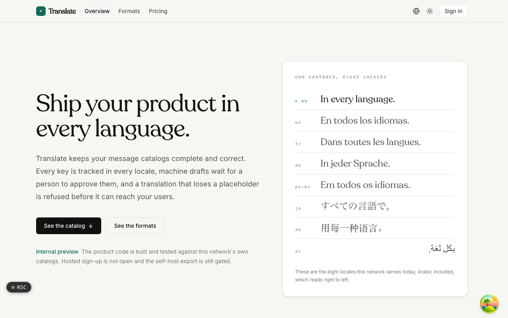
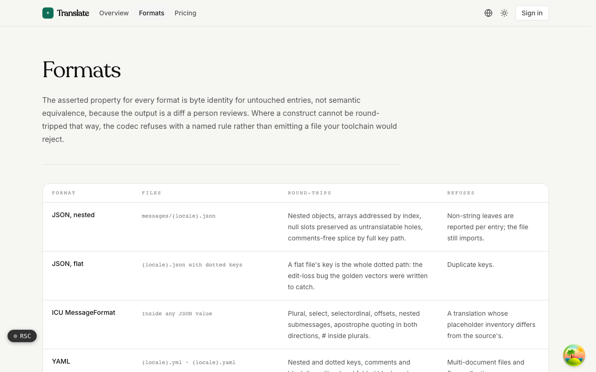
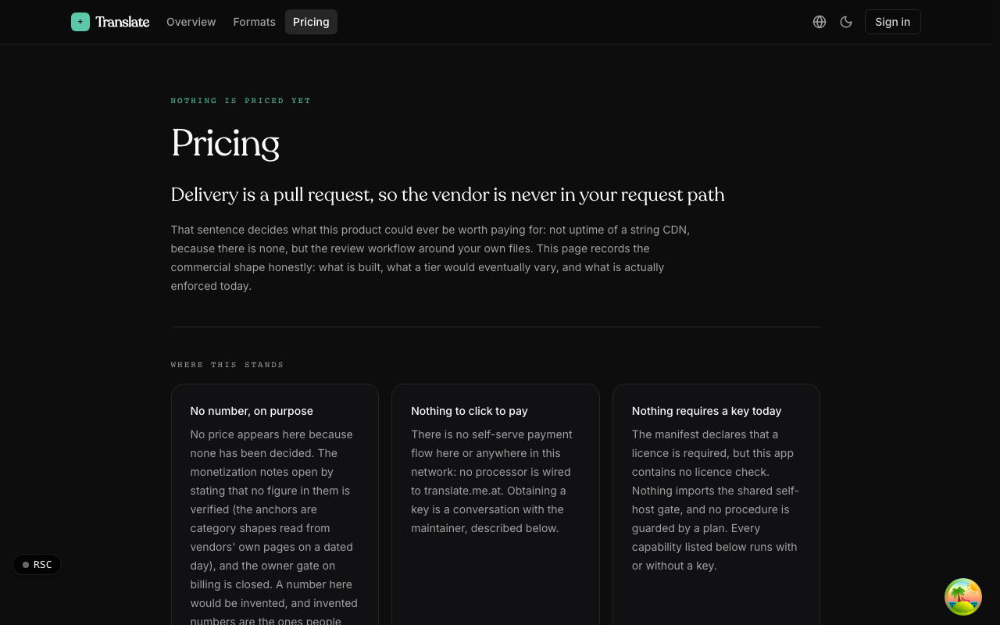

  <picture>
    <source media="(prefers-color-scheme: dark)" srcset=".github/assets/hero-dark.png">
    
  </picture>

# translate.me.at

Ship your product in every language.

Translate is a localization workbench that keeps your message catalogs complete and correct. Every key is tracked in every locale, machine drafts wait for a person to approve them, and a translation that loses a placeholder is refused before it can reach your users. Translated files live in your own repository the way your code does: there is no SDK and no string CDN in your users' request path, so every string you ever translated stays in your git history.

## Features

- **Placeholder and ICU checks**: a real ICU MessageFormat parser (apostrophe quoting, nesting, `#` inside plurals) validates every write, and a translation that adds, drops or renames a placeholder is rejected.
- **Human review that cannot be overwritten**: machine drafts, memory matches and imports can never replace text a person approved.
- **Staleness and drift report**: each translation remembers the source it was written against, and every key in every locale gets exactly one state (translated, missing, empty, identical to the source, stale, or identical on purpose).
- **Twelve formats, byte-faithful**: nested and flat JSON, ICU, YAML, `.properties`, gettext PO, XLIFF, Android `strings.xml`, iOS `.strings` / `.stringsdict` / String Catalog, Flutter ARB and TMX, with untouched entries re-emitted from their original bytes so diffs stay small.
- **Metered machine translation**: off until you set a monthly budget, checked before the first call, with every draft validated against the source's placeholders.
- **Translation memory and glossary**: exact and fuzzy matches over your own approved strings (never cross-tenant), plus do-not-translate terms in a plain JSON file in your repo.
- **Delivery into your repo**: a GitHub Action that opens one draft pull request per locale and never merges, plus a command-line runner that writes files and a translation lock in place.
- **Self-hostable**: Postgres, your own GitHub App and your own machine-translation provider.

## Screenshots

<table>
  <tr>
    <td width="50%"><picture><source media="(prefers-color-scheme: dark)" srcset=".github/assets/formats-dark.png"></picture> Formats: what each codec round-trips and what it refuses</td>
    <td width="50%"> Pricing: what a paid tier would vary, and what is enforced today</td>
  </tr>
</table>

## Built with

- Next.js 16 (App Router), React 19, TypeScript
- Tailwind CSS 4
- next-intl (the marketing site is served in eight locales, Arabic included)
- Drizzle ORM + Postgres
- Better Auth
- oRPC + TanStack Query
- Pluggable machine translation: a hosted model, a self-hosted model endpoint, or LibreTranslate
- GitHub Actions for pull-request delivery

## Part of the me.at family

translate.me.at is one of the [`*.me.at`](https://me.at) apps by Trevor McDougald. They share one design system, account, and app shell. Development happens in a private monorepo; this repository is the project's public-facing home.

## License

See [LICENSE](LICENSE).
