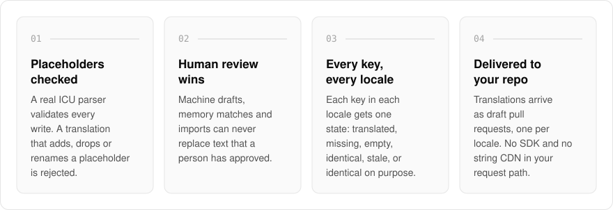
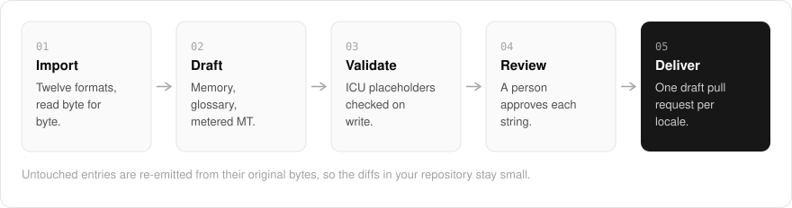

  <picture>
    <source media="(prefers-color-scheme: dark)" srcset=".github/assets/hero-dark.png">
    
  </picture>

<h1 align="center">translate.me.at</h1>

<strong>Ship your product in every language.</strong>

  
  
  
  

  <a href="#features">Features</a> ·
  <a href="#how-it-works">How it works</a> ·
  <a href="#screenshots">Screenshots</a> ·
  <a href="#built-with">Built with</a>

Translations break quietly: a dropped placeholder, a stale string, a machine draft written over a reviewed one. I built translate.me.at as a localization workbench that keeps your message catalogs complete and correct. Every key is tracked in every locale, machine drafts wait for a person to approve them, and a translation that loses a placeholder is refused before it can reach your users. Translated files live in your own repository the way your code does, so there is no SDK and no string CDN in your users' request path.

  <picture>
    <source media="(prefers-color-scheme: dark)" srcset=".github/assets/overview-dark.svg">
    
  </picture>

## Why translate.me.at

| The usual localization platform | translate.me.at |
| --- | --- |
| An SDK or string CDN in your request path | Files in your repository, delivered as draft pull requests |
| Machine output can overwrite reviewed text | Approved text can never be replaced by drafts, memory or imports |
| A broken placeholder ships to users | A translation that changes a placeholder is rejected on write |
| Exports that reformat the whole file | Untouched entries re-emitted from their original bytes |

## Features

- **Placeholder and ICU checks**: a real ICU MessageFormat parser (apostrophe quoting, nesting, `#` inside plurals) validates every write, and a translation that adds, drops or renames a placeholder is rejected.
- **Human review that cannot be overwritten**: machine drafts, memory matches and imports can never replace text a person approved.
- **Staleness and drift report**: each translation remembers the source it was written against, and every key in every locale gets exactly one state (translated, missing, empty, identical to the source, stale, or identical on purpose).
- **Twelve formats, byte-faithful**: nested and flat JSON, ICU, YAML, `.properties`, gettext PO, XLIFF, Android `strings.xml`, iOS `.strings` / `.stringsdict` / String Catalog, Flutter ARB and TMX, with untouched entries re-emitted from their original bytes so diffs stay small.
- **Metered machine translation**: off until you set a monthly budget, checked before the first call, with every draft validated against the source's placeholders.
- **Translation memory and glossary**: exact and fuzzy matches over your own approved strings (never cross-tenant), plus do-not-translate terms in a plain JSON file in your repo.
- **Delivery into your repo**: a GitHub Action that opens one draft pull request per locale and never merges, plus a command-line runner that writes files and a translation lock in place.
- **Self-hostable**: Postgres, your own GitHub App and your own machine-translation provider.

## How it works

  <picture>
    <source media="(prefers-color-scheme: dark)" srcset=".github/assets/flow-dark.svg">
    
  </picture>

Catalogs are imported in any of twelve formats. Drafts come from your own translation memory, your glossary, or metered machine translation, and every write is checked against the source's ICU placeholders. A person approves each string, and the result is delivered as one draft pull request per locale, with untouched entries re-emitted byte for byte.

## Screenshots

<table>
  <tr>
    <td width="50%"><picture><source media="(prefers-color-scheme: dark)" srcset=".github/assets/formats-dark.png"></picture> Formats: what each codec round-trips and what it refuses.</td>
    <td width="50%"><picture><source media="(prefers-color-scheme: dark)" srcset=".github/assets/pricing-dark.png"></picture> Pricing: what a paid tier would vary, and what is enforced today.</td>
  </tr>
</table>

## Built with

  
  
  
  
  
  

- Next.js 16 (App Router), React 19, TypeScript
- Tailwind CSS 4
- next-intl (the marketing site is served in eight locales, Arabic included)
- Drizzle ORM + Postgres
- Better Auth
- oRPC + TanStack Query
- Pluggable machine translation: a hosted model, a self-hosted model endpoint, or LibreTranslate
- GitHub Actions for pull-request delivery

## Part of the me.at family

translate.me.at is one of my [`*.me.at`](https://me.at) apps. They share one design system, one account, and one app shell. Development happens in a private monorepo; this repository is the project's public-facing home.

## License

Source-available. See [LICENSE](LICENSE).
